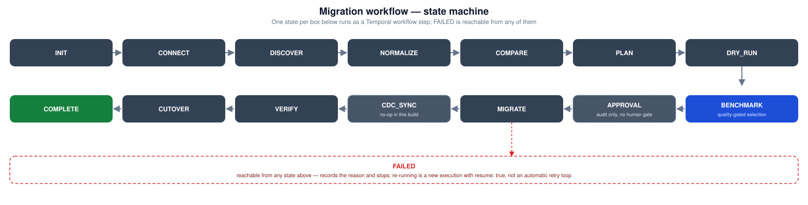
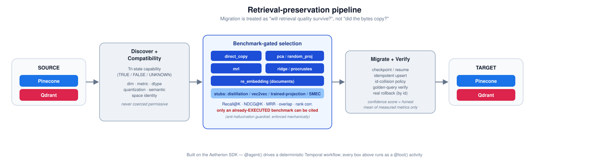

# VectorDB_Migration_Agent


A provider-neutral, **benchmark-gated** vector database migration agent — any-to-any across **Pinecone, Qdrant, Milvus, Chroma, Weaviate, FAISS, and Vespa**. It treats migration as a **retrieval-preservation problem**, not a copy job: a transformation strategy is never trusted just because it ran — it has to clear a real Recall@K/NDCG@K quality gate against an *already-executed* benchmark before it's allowed to touch the target.

Built on the **Aetherion SDK** (Temporal under the hood): `src/agent/agent.py` drives a deterministic workflow through 14 states, `src/tools/*.py` are the `@tool()` activities that do the real work, and `src/core/` is the provider-neutral engine underneath both.

## Why "retrieval-preservation," not "data copy"

Two vector databases rarely agree on dimension, distance metric, storage dtype, or even what the embedding *means* — copying the bytes across can silently produce a target where semantically similar items no longer rank near each other. This agent:

1. **Discovers capabilities honestly** — every check returns `TRUE` / `FALSE` / **`UNKNOWN`**, never guesses permissive when it can't confirm something (a source that can't report its own quantization stays `UNKNOWN`, not `FALSE`).
2. **Classifies compatibility** (dimension, metric, dtype, vector type, quantization, semantic-space identity) before ever proposing a fix.
3. **Generates transform candidates** and **benchmarks every one for real** — a live ground-truth query against the source, and (Qdrant targets only, today) either a real ephemeral collection or a brute-force exact search, never a numpy stand-in. Every other target uses the same real brute-force path.
4. **Only selects a strategy that clears the quality gate**, and only if that exact strategy has a recorded, executed benchmark row behind it — a plan can never cite a candidate that was never tested.
5. **Verifies after migrating** with golden queries transformed into the *target's* space before querying it, checkpoints for resume, and can roll back precisely the ids this run wrote — never a bulk clear of the target.



## Pipeline



## What's real vs. an honest stub

Every strategy below is wired into the same benchmark-gated selection path — the table is what happens if it's actually picked.

| Strategy | Status | Notes |
|---|---|---|
| `direct_copy` | ✅ Real | Identity copy, gated on full compatibility |
| `pca` | ✅ Real | sklearn `PCA`, fit once on the benchmark sample, persisted and reused for the whole migration — never re-fit per batch |
| `random_projection` | ✅ Real | Fixed-seed Gaussian RP, same fit-once/persist pattern |
| `mrl` | ✅ Real | Truncate + renormalize; gated on a confirmed MRL-capable model with a documented supported-dimension entry |
| `ridge_mapping` | ✅ Real | Closed-form `sklearn.Ridge` affine map fit on ≥200 calibration pairs (source vector ↔ freshly re-embedded target-space vector for the same document) — works for any dimension pair |
| `procrustes_mapping` | ✅ Real | Classical orthogonal Procrustes on mean-centered calibration pairs — only defined when source and target dimensions match |
| `re_embedding` | ✅ Real | Calls an OpenAI-compatible `/embeddings` endpoint; gated on document availability |
| RRF hybrid compensation | ✅ Real | Pure rank-fusion arithmetic; not yet wired to a live sparse/BM25 source |
| `matryoshka_adaptor` / `learned_projection` / `retrieval_aware_projection` | ❌ Stub | Share one base class; `prepare()` raises `NotImplementedError` naming the exact training contract required (≥5–10k paired samples, a disjoint validation split, a fixed seed) rather than faking a "trained" fit on whatever sample is on hand |
| `knowledge_distillation` | ❌ Stub | Same standard as above |
| `vec2vec` | ⚠️ Gating real, training stubbed | `can_apply()` implements the real worst-case decision logic (only surfaces once every semantic alternative is exhausted); the adversarial training itself needs a multi-day job over a large unpaired corpus, not implemented |
| `smec` | ❌ Honestly impossible here | A training-time compression objective jointly learned with the source encoder — cannot be retrofitted onto vectors a frozen model already produced. The only honest path is re-embedding with a SMEC-trained model, i.e. `re_embedding`, not a migration-time transform |

## Providers

Every provider implements the same `VectorDBAdapter` contract (`src/core/adapters/base.py`) — the compatibility engine, transformers, and orchestrator never branch on provider name.

| Provider | Status | Notes |
|---|---|---|
| `pinecone` | ✅ Real, live-verified | Hand-rolled REST (`httpx`), live-verified against a real Pinecone account |
| `qdrant` | ✅ Real, live-verified | `qdrant_client`; the only target with real-ANN ephemeral-collection benchmarking today |
| `milvus` | ✅ Real, live-verified | `pymilvus` `AsyncMilvusClient` (Zilliz Cloud or self-hosted); live-verified against a real Zilliz Cloud cluster |
| `chroma` | ✅ Real, live-verified | `chromadb`; live-verified against Chroma Cloud. Only provider where `retrieve_documents` is a real, first-class capability, not a payload convention |
| `weaviate` | ✅ Real, live-verified | `weaviate-client` v4 async collections API; live-verified against Weaviate Cloud — a real bug in target-vector addressing for single-vector collections was caught and fixed by that live test, not by inspection |
| `faiss` | ✅ Real, local-only by design | No server, no credentials, no native metadata store — a `.faiss` index file + a JSON sidecar for ids/payload/namespace. Always testable locally; see `core/adapters/faiss_adapter.py` for the documented reconstruction and upsert tradeoffs |
| `vespa` | ✅ Real implementation | Hand-rolled REST against Vespa's Document API v1 (same architectural choice as Pinecone, not the `pyvespa` package). Two permanent, honest capability gaps: no schema-introspection call exists on the data plane (dimension/metric/count stay unknown), and vector search needs a pre-configured rank profile in the deployed schema |

## What this deliberately does not do (yet)

| Capability | Status | Why |
|---|---|---|
| Human approval gate before `MIGRATE` | ❌ | `humanInput.request_approval()` depends on an SDK activity (`register_human_input_request`) confirmed absent from the tool worker's registry on the deployed SDK version (a real `NotFoundError`, live-verified, not a guess) — removed rather than left silently hanging. `APPROVAL` still records recall/NDCG/strategy in the audit trail, just with no pause for sign-off |
| True CDC / continuous sync | ❌ | `CDC_SYNC` exists as a first-class workflow state, but neither shipped adapter reports `migration.cdc = TRUE` — it's a capability-gated no-op today, not a fake listener pretending to tail changes |
| Trained neural projections (Matryoshka-Adaptor, Learned Projection, Retrieval-Aware Projection, distillation) | ❌ | Each needs a real training loop and thousands of paired samples; faking one on a small sandbox-sized sample would produce a plausible-looking but methodologically bogus recall number |
| Canonical vector store / vendor-neutral intermediate storage | ❌ | A genuinely new durable-state layer between `DISCOVER` and `MIGRATE`, not a bounded addition to existing tools |
| Shadow retrieval / dual-write validation | ❌ | Needs a live query-traffic interception point; this is a batch migration tool, not a proxy |
| Real-ANN benchmarking for non-Qdrant targets | ❌ | Milvus/Chroma/Weaviate/FAISS/Vespa targets use the same real brute-force benchmark path Pinecone-as-target already used — an ephemeral-collection ANN benchmark like Qdrant's is a documented future extension, not silently missing |
| Vespa real multi-tenancy / native namespaces | ❌ | Namespace is folded into a reserved field + filter, same convention every provider without a native tenant concept uses — a real per-tenant routing feature (where one exists, e.g. Weaviate's multi-tenancy) isn't wired up |

## Getting started

Requires Python 3.12 and [`uv`](https://docs.astral.sh/uv/).

```bash
uv sync
source .venv/bin/activate
```

```bash
aetherion config init
aetherion login --env sbox --tenant <your-tenant>
```

### Running it locally

```bash
aetherion run --tool     # tool worker
aetherion run --agent    # agent worker, separate terminal
```

Trigger `VectorDB_Migration_Agent` directly:

```bash
aetherion agent VectorDB_Migration_Agent '{
  "migration_id": "demo-001",
  "source_provider": "pinecone",
  "source_resource": "my-index",
  "source_credential_ref": "PINECONE_API_KEY",
  "target_provider": "qdrant",
  "target_resource": "my-collection",
  "target_credential_ref": "QDRANT_API_KEY",
  "id_collision_policy": "overwrite"
}' --wait
```

### Trigger payload reference

| Field | Required | Notes |
|---|---|---|
| `migration_id` | yes | Unique id for this run — also the checkpoint/resume key |
| `source_provider` / `target_provider` | yes | `pinecone`, `qdrant`, `milvus`, `chroma`, `weaviate`, `faiss`, or `vespa`, typed exactly |
| `source_resource` / `target_resource` | yes | Index/collection name. Vespa: `<namespace>/<document-type>`. FAISS: any placeholder — identity comes from `*_endpoint_ref` |
| `source_credential_ref` / `target_credential_ref` | yes | A real API key/token pasted directly, or an environment variable name the worker already has set. Required by the schema even for faiss/self-hosted-without-auth, where it's accepted but ignored |
| `source_endpoint_ref` / `target_endpoint_ref` | no\* | A literal URL, `memory` for a local Qdrant/Chroma/Weaviate instance, `path://<dir>` (Chroma persistent) or `cloud://<tenant>/<database>` (Chroma Cloud), or an environment variable name. \*Required for `faiss` (local index file path) and `vespa` (base URL) |
| `id_collision_policy` | no | `fail` (default) / `overwrite` / `skip` / `rename` / `prefix` — what happens when a source id already exists in the target |
| `resume` | no | `true` resumes a previously terminated run with the same `migration_id` from its last checkpoint |

### Publishing

```bash
aetherion publish
```

## Testing

```bash
uv run pytest
```

217 tests — unit tests need no external credentials at all. Milvus/Chroma/FAISS have real local round-trip unit tests (Milvus Lite, Chroma `EphemeralClient`, FAISS's own local index file — no server for any of them), Weaviate/Vespa unit tests cover id-mapping/request-shaping helpers directly (`httpx.MockTransport` for Vespa). The integration suite (`tests/integration/test_qdrant_roundtrip.py`) uses a local, on-disk Qdrant instance for both "source" and "target," so it needs no live account either.

## Project layout

```
src/
  core/
    models/            # canonical_ir.py, capability.py (tri-state), migration_plan.py, workflow_state.py, benchmark.py, provenance.py
    adapters/           # pinecone/qdrant/milvus/chroma/weaviate/faiss/vespa adapters + base.py (shared contract)
    compatibility/      # dimension/metric/dtype/quantization/semantic-space classification engine
    transformations/    # direct, pca, random_projection, mrl, ridge/procrustes mapping, re_embedding,
                        # rrf + honest stubs: trained_projection, distillation, vec2vec, smec
    benchmarking/       # Recall@K/NDCG@K/MRR/overlap/rank-correlation engine
    optimizer/          # multi-objective scorer + confidence score
    validation/         # integrity diff, distribution-stats fidelity gate
    checkpointing/      # JSON checkpoint store, resume-from-state
    security/           # redaction applied at every report boundary
  tools/                # @tool()-decorated Temporal activities — the only callers of src/core/
  agent/                # @agent()-decorated Temporal workflow (agent.py) + metadata.json (dashboard triggers)
tests/
  unit/                 # pure logic, mocked-transport adapters (Pinecone/Vespa), and real
                        # local-mode adapter round-trips (Qdrant/Milvus/Chroma/FAISS)
  integration/          # real local Qdrant round-trip, including rollback and pipelined batching
docs/
  ARCHITECTURE.md        # full design of record — state machine, what's real vs. stub and why, every deferred item and its reason
  images/                # the diagrams in this README
```

## Honest limitations, stated directly

- Benchmark recall is bounded by how much of the real corpus the `DRY_RUN` sample covers — a production-scale migration will see materially lower raw recall numbers than this sample-based gate reports, by design of sampling itself, not as a defect.
- `dequantize.py` is a best-effort linear rescale (int8 ÷ 127, binary → ±1) — neither adapter can discover the true provider-specific quantization scale today.
- Pinecone's pinned `X-Pinecone-Api-Version` will age out again over time (Pinecone versions have a ~12-month support window) — it's a constructor parameter specifically so that's a config change, not a code change, when it happens.
- Re-embedding during `MIGRATE` requires the caller to set `document_field` in the trigger payload — there's no generic document-discovery path today.
- The real-ANN benchmark path's concurrent candidates share one Qdrant connection under an `asyncio.Lock` (Qdrant's local/on-disk mode locks its storage path per open client) — correct, but candidate evaluations against a Qdrant target are only as parallel as that lock allows.
- FAISS has no true upsert primitive — implemented as `remove_ids` + `add_with_ids` followed by a synchronous `faiss.write_index()` per batch, so every write is durable immediately at the cost of a full index rewrite. `IndexIDMap2.reconstruct_n()` was confirmed live to crash the whole Python process (not raise a catchable exception) when wrapping a mapped index, so this adapter only ever calls `reconstruct()` one real id at a time.
- Vespa's data-plane REST API exposes no schema-introspection call at all — dimension, metric, and vector count are permanently `None`/`UNKNOWN` unless the operator supplies them, not a gap this adapter can close.
- Weaviate/Chroma/FAISS have no native namespace/tenant concept — namespace is folded into a reserved field + filter, same convention across all three, rather than using a provider-native mechanism (e.g. Weaviate's real multi-tenancy) where one exists.
- **Confirmed live**: a genuinely empty Chroma or Weaviate target has no discoverable dimension at all — neither declares one at collection-creation time (unlike Pinecone/Qdrant/Milvus/FAISS, which fix it in their schema/index config regardless of whether data exists yet); it's only inferable from a real stored vector. `run_compatibility_check` correctly reports `dimension: unknown` for a fresh empty Chroma/Weaviate target and blocks `direct_copy` — the tri-state system refusing to guess, not a defect — but it means those two providers can't be a *migration target* until their dimension is confirmed some other way. A real end-to-end proof against a fresh empty target therefore used Milvus → FAISS (both declare dimension upfront), not Chroma or Weaviate as the target.

Live-verified, not just tested against mocks: two real runs against a live Pinecone account (48 real sentence embeddings, migrated into both a local Qdrant instance and a real Qdrant Cloud cluster), the actual Temporal workflow — not just its `@tool()` coroutines called directly — run through a live Aetherion sandbox worker (`docs/ARCHITECTURE.md`'s Phase 14), and real live connect/upsert/query/scan/delete round trips against a live Zilliz Cloud (Milvus), Chroma Cloud, and Weaviate Cloud instance apiece.

See `docs/ARCHITECTURE.md` for the full design of record, every phase's live-testing notes, and the complete, dated list of what was deferred and why.
